# অধ্যায় ৩: ইশারা-অভিধান (ছবিসহ)

প্রতিটি ভঙ্গির জন্য একটি প্রতীকী ডায়াগ্রাম, তারপর **কোন উৎস কী অর্থ দাবি করে**। লাল রেখা দিয়ে চিহ্নিত আঙুলগুলো সেই ইশারার মূল অংশ।

> **মনে রাখুন:** এখানে প্রতিটি "অর্থ" উৎসের দাবি। ডায়াগ্রাম প্রতীকী; বাস্তবে প্রবক্তারা ডান/বাম হাত, তালু ওপরে/নিচে ইত্যাদি পার্থক্যও করেন।

### উৎস-সংক্ষেপ (এই অধ্যায়ে)

| সংক্ষেপ | উৎস |
|---|---|
| **ওয়াশ্শাহ** | তাইসির আল-ওয়াশ্শাহর ফোরাম/বই (জর্ডান, ২০০৯–১০) |
| **আমজাদ** | আমজাদ আব্দুর রউফ মাহমুদের বই থেকে উদ্ধৃত "তাওয়াবি'" তালিকা (জর্ডান) |
| **২০১৭-সংকলন** | ফোরাম-লেখার ২০১৭ সালের ব্লগ-সংকলন ("জিনের ধর্ম" তালিকা) |
| **৯-দফা** | তারেক আল-বান্না (sa7il, ২০১৮) ও রাকি আবু ওয়ালিদ (২০২০)-এর অভিন্ন তালিকা |
| **মাওসুআ** | mosoah.com / mrahba.com (২০২১) |
| **মাফাহিম** | mafahem.com (২০২৩) |
| **ইনফোগ্রাফিক** | ৯-ছবির আরবি ইনফোগ্রাফিক ও সঙ্গের লেখা (২০২৩) |
| **৩০-কার্ড** | "লিয়াতমাইন্না কালবুক" চ্যানেলের ছবি-কার্ড (adam11eve.com, ২০২৪) |
| **তারদা** | ড. মুরাদ তারদা, টিকটক (২০২৪–২৫) |
| **কড়ে-পোস্ট / তর্জনী-পোস্ট** | কন্টেন্ট-ফার্ম ব্লগের নির্দিষ্ট পোস্ট (২০২৫–২৬) |

---

## ৩.১ সব আঙুল ফাঁক (খোলা হাত)

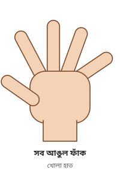

| উৎস | দাবিকৃত অর্থ |
|---|---|
| ওয়াশ্শাহ | «انفراج جميع الأصابع ← مس فعلي» — বাস্তব জিনের আসর |
| ইনফোগ্রাফিক | «الجن من صنف الطيار» — উড়ন্ত শ্রেণির জিন |
| ৩০-কার্ড | «وجود سحر عام» — সাধারণ জাদু; তালু ওপরে, আঙুল জোড়ায় জোড়ায়: «أسحار متعدده» — একাধিক জাদু |
| ইনফোগ্রাফিক (ছবি-অংশ) | কারীন বা কারীনা (পুরুষের ডান হাতে, নারীর বাম হাতে) |
| তারদা | আঙুল ছড়ানো বা একটার মধ্যে আরেকটা ঢোকানো: বিচ্ছেদ-জাদু (سحر التفريق) |
| ফেসবুক (আবু হাম্মাম) | «انفراج الأصابع… لكونها مخارج للطاقة» — আঙুল "শক্তি বের হওয়ার পথ" বলে ফাঁক হয় |

**অমিল:** একই ভঙ্গির পাঁচটি আলাদা অর্থ — জিনের আসর, উড়ন্ত জিন, সাধারণ জাদু, কারীন, বিচ্ছেদ-জাদু।

---

## ৩.২ মুষ্টি

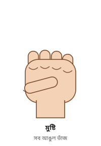

| উৎস | দাবিকৃত অর্থ |
|---|---|
| ৯-দফা, মাওসুআ, মাফাহিম | «إشارة اليد مضمومة للداخل أو قبضة اليد … تابع من الجن وهو مس جزئي» — জিনের তাবি' (অনুসারী), শরীরে আংশিক আসর |
| ইনফোগ্রাফিক | «تدل على قوة ملك الجن» — জিনদের রাজার শক্তি |
| তারদা | মুষ্টি = জিনদের রাজা (مَلِك) |
| ইনফোগ্রাফিক (ছবি-অংশ) | স্পর্শ প্রত্যাখ্যানকারী প্রেমিক-জিন (عاشق) |
| তর্জনী-পোস্ট / ২০২৬ ব্লগ | অন্য আঙুল মুঠো: পুরোনো বন্ধন-জাদু; মুষ্টি ও কবজি শক্ত: দাফন করা বা পুরোনো জাদু |
| ওয়াশ্শাহ | মুষ্টি সামনে + পুরো শরীর কাঁপা: «الاستحواذ الشيطاني» — শয়তানি দখল; মুষ্টি ওপরে তোলা: জিন প্রকাশ হয়ে রাকিকে চ্যালেঞ্জ করছে |

**অমিল:** "আংশিক আসরের ছোট অনুসারী" বনাম "জিনদের রাজা" — দুটি প্রায় বিপরীত অর্থ।

---

## ৩.৩ তর্জনী উঁচু (তাওহীদের ইশারা)

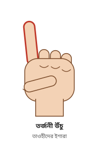

| উৎস | দাবিকৃত অর্থ |
|---|---|
| ২০১৭-সংকলন | ডান তর্জনী ওঠা = মুসলিম জিন |
| ইনফোগ্রাফিক | «حركة التوحيد تدل على وجود الجن المسلم» — তাওহীদের ইশারা, মুসলিম জিন |
| তারদা | তর্জনী উঁচু = মুসলিম জিন |
| ২০২৬ ব্লগ | মুসলিম জিন সাহায্য করছে, যা শুধু "যুহরি" ব্যক্তির মধ্যে পাওয়া যায় |
| তর্জনী-পোস্ট | আক্রমণকারী তাওহীদে প্রভাবিত; «علامات النصر والشفاء» — বিজয় ও আরোগ্যের লক্ষণ। কাঁপা + ঠান্ডা তালু = বদনজর/হাসাদ বের হচ্ছে |
| ৩০-কার্ড | তর্জনী জোরে ওঠানামা: «العارض يطلب من الراقى التفاوض للخروج» — আক্রমণকারী বের হওয়ার জন্য রাকির সঙ্গে আলোচনা চাইছে |
| ২০১৭-সংকলন | **বাম** তর্জনী তাওহীদের আয়াতে ইশারা করে = কাফির, অবাধ্য জিন |
| ওয়াশ্শাহ | তর্জনী রাকির দিকে তাক করে হুমকির ভঙ্গি = প্রকাশিত জিনের চ্যালেঞ্জ |

**বিশেষ লক্ষণীয়:** এটি নামাজের তাশাহহুদে প্রত্যেক মুসলমানের নিয়মিত করা ভঙ্গি। ২০১৭-সংকলন নিজেই সতর্ক করে যে এই অর্থ জানার পর রোগীর তর্জনী উঠবে এবং "জিন মুসলিম দাবি করে ধোঁকা দেবে"।

---

## ৩.৪ তর্জনী-মধ্যমা (V চিহ্ন)

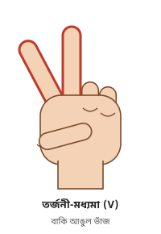

| উৎস | দাবিকৃত অর্থ |
|---|---|
| ৯-দফা, মাওসুআ, মাফাহিম | «إشارة اليد بالسبابة والوسطى منفرجة تدل على اقتران شيطاني خارجي ماس» — বাইরে থেকে লেগে থাকা শয়তানি সংযোগ (ইকতিরান) |
| ইনফোগ্রাফিক | «تدل على سحر القرين» — কারীনের জাদু |
| ২০২৬ ব্লগ (একই ইনফোগ্রাফিকের ব্যাখ্যা) | «سحر القريب» — আত্মীয়ের করা জাদু |
| ইনফোগ্রাফিক (ছবি-অংশ) | মূর্তিপূজারি বা অনুসারী জিন |

**অমিল:** তিনটি ভিন্ন অর্থ; একই ইনফোগ্রাফিকের দুই ব্যাখ্যাতে "কারীন" ও "কারীব" (আত্মীয়) — সম্ভবত শ্রুতিভুল।

---

## ৩.৫ শিং (তর্জনী + কড়ে উঁচু)

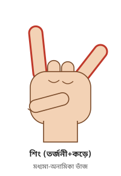

| উৎস | দাবিকৃত অর্থ |
|---|---|
| ২০১৭-সংকলন | «قبض الإبهام والأصبعين بالوسط» — বুড়ো আঙুল ও মাঝের দুই আঙুল মুঠো: শয়তান, "পরিচিত শয়তান-পূজারি প্রতীক" |
| ইনফোগ্রাফিক | «حركة الشيطان – خادم سحر/عين/حسد» — শয়তানের ইশারা: জাদু/বদনজর/হাসাদের খাদেম |
| তারদা | শয়তানের প্রতি সম্মান, "ইহুদি" শয়তান |
| ২০২৬ ব্লগ | «تعظيما لإبليس» — ইবলিসের সম্মানে |
| ইনফোগ্রাফিক (ছবি-অংশ) | অবাধ্য মারিদ — কালো জাদুর শয়তান |

---

## ৩.৬ বুড়ো আঙুল-তর্জনীর বৃত্ত ("OK" / "চোখ")

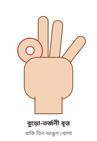

| উৎস | দাবিকৃত অর্থ |
|---|---|
| ৯-দফা (বাকি আঙুল **জোড়া**) | «إشارة اليد بضم الإبهام والسبابة وجعلهم مثل العين والتصاق باقي الأصابع … جن من عبدة الشيطان وغالبا جن سفلي» — শয়তান-পূজারি জিন, প্রায়ই নিম্নস্তরের (সুফলি) |
| ৯-দফা (বাকি আঙুল **ছড়ানো**) | «بضم الإبهام والسبابة مع تفريق باقي الأصابع … جن نصراني ماس الجسد» — খ্রিস্টান জিন |
| মাওসুআ, মাফাহিম | বৃত্ত = সুফলি জিন; বুড়ো-তর্জনী মিলিত = খ্রিস্টান জিন |
| ইনফোগ্রাফিক | «حركة العين الماسونية» — ফ্রিম্যাসনি চোখ |
| তারদা | ফ্রিম্যাসনি বদনজর |

**লক্ষণীয়:** বাকি তিন আঙুল একসঙ্গে আছে নাকি ফাঁক — এই সূক্ষ্ম পার্থক্যে অর্থ "শয়তান-পূজারি" থেকে "খ্রিস্টান" হয়ে যায়।

---

## ৩.৭ L আকার (তর্জনী উঁচু, বুড়ো আঙুল বাইরে)

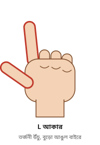

| উৎস | দাবিকৃত অর্থ |
|---|---|
| ইনফোগ্রাফিক | «حركة الصليب – الجن النصارى» — ক্রুশের ইশারা, খ্রিস্টান জিন |
| তারদা | ক্রুশ ভঙ্গি = খ্রিস্টান জিন |
| ৩০-কার্ড | L আকারের হাত পেটের ওপর: «سحر فى البطن مأكول او مشروب» — পেটে খাওয়ানো/পান করানো জাদু |

---

## ৩.৮ কড়ে আঙুল সামান্য ফাঁক

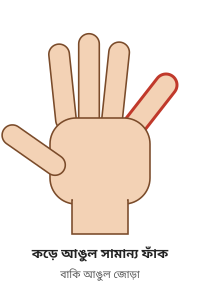

| উৎস | দাবিকৃত অর্থ |
|---|---|
| ওয়াশ্শাহ | «انفراج الخنصر انفراجا قليلا ← سحر ربط» — বন্ধন-জাদু (সিহর রবত) |
| ৯-দফা, মাফাহিম | «بضم الأصابع وانفراج الخنصر تدل على المس من تابع عاشق من الجن» — প্রেমিক অনুসারী জিন |
| ৩০-কার্ড | সামান্য ফাঁক + ওপরে ওঠা: «سحر عائلي مشترك» — পরিবারের সবার ওপর যৌথ জাদু |
| কড়ে-পোস্ট | «قرين الرجل يستقر في خنصر اليد اليمنى، وقرين المرأة… اليسرى» — পুরুষের কারীন ডান কড়ে আঙুলে, নারীর বাম কড়ে আঙুলে; উল্টো দিকে হলে বিপরীত লিঙ্গের জাদু-খাদেম — «دليل لا يقبل الجدل» ("তর্কাতীত প্রমাণ") |
| তারদা | কড়ে আঙুল খোলা = বিয়ে আটকানোর বন্ধন-জাদু |
| ফেসবুক (নগাউস, আলজেরিয়া) | কড়ে ও অনামিকা ৫ ডিগ্রির বেশি খোলা + ঠান্ডা = দ্বিগুণ হাসাদ/আইন |
| আমজাদ / তাওয়াবি' তালিকা | কড়ে আঙুল "৫ ডিগ্রি" ফাঁক হয়ে নড়ে = তাবি' |

**অমিল:** এটি সম্ভবত সবচেয়ে আলোচিত সংকেত, আর অর্থও সবচেয়ে বেশি — বন্ধন-জাদু, প্রেমিক জিন, পারিবারিক জাদু, কারীন, তাবি'।

---

## ৩.৯ কড়ে আঙুল অনেক ফাঁক

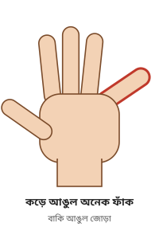

| উৎস | দাবিকৃত অর্থ |
|---|---|
| ওয়াশ্শাহ | «انفراج الخنصر انفراجا كبيرا ← حسد» — হাসাদ (ঈর্ষা/বদনজর) |
| ওয়াশ্শাহ (ব্যাখ্যা) | হাসাদের সংকেত কখনো শুধু কড়ে আঙুলের সামান্য ঢিলে হয়ে নিচে নামা, বা ওপরে উঠে স্থির থাকা |

**লক্ষণীয়:** ওয়াশ্শাহ পদ্ধতিতে "সামান্য" ফাঁক = জাদু, "অনেক" ফাঁক = হাসাদ। কত ডিগ্রি হলে "সামান্য" আর কত হলে "অনেক", তার কোনো মাপ দেওয়া নেই।

---

## ৩.১০ কড়ে + অনামিকা ফাঁক

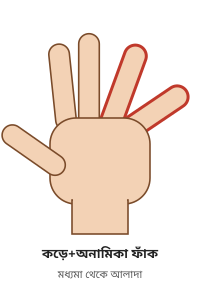

| উৎস | দাবিকৃত অর্থ |
|---|---|
| ওয়াশ্শাহ | «انفراج الخنصر والبنصر بشكل متوسط أو كبير ← حسد مزدوج» — দ্বিগুণ হাসাদ |
| ওয়াশ্শাহ | কড়ে ও অনামিকা ফাঁক, বিশেষত অনামিকা দোলে: «توابع» — একাধিক তাবি' |
| তাওয়াবি' তালিকা | কড়ে ও অনামিকা দোলা, কখনো বুড়ো আঙুলও = তাবি' |

---

## ৩.১১ তর্জনী + কড়ে ফাঁক (দুই প্রান্ত)

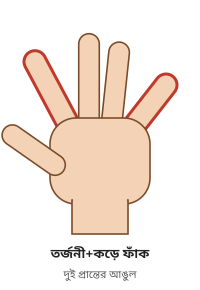

| উৎস | দাবিকৃত অর্থ |
|---|---|
| ওয়াশ্শাহ | «انفراج الخنصر والشاهد انفراجا قليلا أو كبيرا ← سحر عام» — সাধারণ জাদু |

---

## ৩.১২ মধ্যমা ও অনামিকার মাঝে ফাঁক

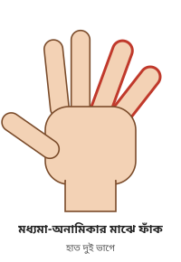

| উৎস | দাবিকৃত অর্থ |
|---|---|
| ওয়াশ্শাহ | «انفراج بين الوسطى والبنصر ← تعدد إصابات» — একাধিক আক্রান্তি |
| উর্দু ফেসবুক (রোগীর প্রশ্ন) | তর্জনী-মধ্যমা একসঙ্গে, অনামিকা-কড়ে একসঙ্গে, মাঝে ফাঁক: রোগী জানতে চান এটা "বিয়েতে বাধা"র সংকেত কি না (উত্তর দেখা যায়নি) |

---

## ৩.১৩ তর্জনী অনেক ফাঁক / আলাদা

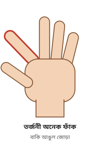

| উৎস | দাবিকৃত অর্থ |
|---|---|
| ওয়াশ্শাহ | «انفراج الشاهد انفراجا كبيرا ← تابع عشق» — প্রেমিক অনুসারী জিন; স্থির থাকলে এবং প্রেমিক-লক্ষণ না থাকলে: «عين إعجاب» — মুগ্ধতার বদনজর |
| ওয়াশ্শাহ | তর্জনী ওপর-নিচ কাঁপা: «تابع» — অনুসারী জিন |
| আমজাদ | তর্জনী বাইরের দিকে "৫ ডিগ্রি" ফাঁক = «توابع عشق» |
| ৩০-কার্ড | সামান্য ও স্থির ফাঁক: «وجود عين» — বদনজর; জোরে ও অস্থির ফাঁক: «مس عاشق» — প্রেমিক জিনের আসর |
| তাওয়াবি' তালিকা | তর্জনী নিচে নামা = তাবি' |

**আংশিক মিল:** কয়েকটি উৎস তর্জনীর ফাঁককে "প্রেমিক জিন"-এর সঙ্গে যুক্ত করে।

---

## ৩.১৪ মধ্যমা নিচে নামা

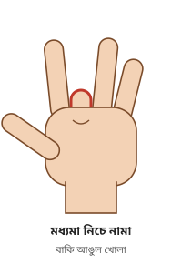

| উৎস | দাবিকৃত অর্থ |
|---|---|
| ওয়াশ্শাহ, ২০১৭-সংকলন, রিয়াদ-পোস্ট | «سقوط الإصبع الأوسط بتدرج حتى يتم ثباته بالأسفل يدل على إصابة السحر السفلي» — ধীরে নেমে নিচে স্থির = নিম্নস্তরের (সুফলি) জাদু |
| রিয়াদ-পোস্ট (ব্যাখ্যা) | শয়তানরা সবচেয়ে লম্বা আঙুলকে "বড়" মনে করে, তাই খাদেমের উঁচু মর্যাদা (মারিদ শ্রেণি) বোঝায়; সুফলি জাদু "নিম্ন আত্মা ও শনি গ্রহ" থেকে |
| ওয়াশ্শাহ | মধ্যমা পুরো ও অনামিকা অর্ধেক নামা = জাদু, সঙ্গে «عهد سفلي» (নিম্ন চুক্তি) |
| ৩০-কার্ড | রুকইয়ার সময় মধ্যমা নামা + কান্না: «جن غواص خادم لسحر مدفون» — দাফন করা জাদুর খাদেম ডুবুরি জিন |

এই অর্থটি বিভিন্ন "রুহানি বিজ্ঞান" (العلوم الخفية) ফেসবুক পেজেও হুবহু পাওয়া যায় **[পরোক্ষ]**।

---

## ৩.১৫ শুধু মধ্যমা উঁচু / নড়াচড়া

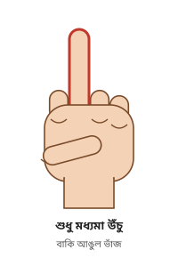

| উৎস | দাবিকৃত অর্থ |
|---|---|
| ৩০-কার্ড | «العارض يسعى للمصاب فى الذله والاحتقار» — আক্রমণকারী রোগীকে অপমানিত করতে চায় (কারণ বদনজর, জাদু বা জিন) |
| ৩০-কার্ড | মধ্যমা ওপরে + কাঁধ-ঘাড়ে ব্যথা: পুঞ্জীভূত বদনজর + খাওয়ানো জাদু; মধ্যমা নড়া + বাম পায়ে ঝিনঝিন: দাফন করা বিচ্ছেদ-জাদু |
| তারদা (২০২৫) | শুধু মধ্যমা ওঠা = মারিদ বা জিনদের রাজা; অন্য উপসর্গ মিলিয়ে বিভিন্ন জাদু (অধ্যায় ৪) |
| ২০২৬ ব্লগ | মধ্যমা নড়া, অবশ, গরম বা ঠান্ডা = «دليل قوي (100%) على وجود سحر تفريق» — "বিচ্ছেদ-জাদুর ১০০% শক্ত প্রমাণ"; আপনা-আপনি সামনে-পেছনে = রাগের জাদু |
| ইনফোগ্রাফিক-পোস্ট | ডান হাতের মধ্যমা = উড়ন্ত জিন |

**লক্ষণীয়:** সমাজে এটি অশ্লীল ভঙ্গি। রোগীর হাত এমন হলে প্রবক্তারা একে "অপমান করার ইচ্ছা" বলেন।

---

## ৩.১৬ বুড়ো আঙুল তর্জনী-মধ্যমার মাঝে

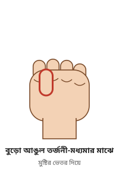

| উৎস | দাবিকৃত অর্থ |
|---|---|
| ওয়াশ্শাহ, ২০১৭-সংকলন | «دخول الإبهام بين الشاهد والوسطى أو بين الوسطى والبنصر … يدل على رغبة الجن المعتدي بممارسة الجنس» — আক্রমণকারী জিনের যৌন-ইচ্ছা |
| আমজাদ | «توابع سيئة» — খারাপ তাবি' |
| ৩০-কার্ড | «توابع لإصابات متعدده (سحر، عين، مس)» — একাধিক আক্রান্তির তাবি' |

---

## ৩.১৭ বুড়ো আঙুল মধ্যমা-অনামিকার মাঝে

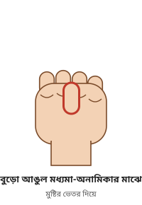

| উৎস | দাবিকৃত অর্থ |
|---|---|
| ওয়াশ্শাহ, ২০১৭-সংকলন | জিনের যৌন-ইচ্ছা (উপরের মতো) |
| আমজাদ | «توابع الجنس» — যৌন তাবি'; সঙ্গে হাত-পায়ে খিঁচুনি, পূর্ণ আসরে মূর্ছা |
| ৩০-কার্ড | মূর্ছাসহ: «مس عاشق زاني» — ব্যভিচারী প্রেমিক জিন |

**মিল:** তিনটি উৎসই একে যৌন বিষয়ের সঙ্গে যুক্ত করে — এই তালিকায় সবচেয়ে বেশি মিল এখানেই। লক্ষণীয়: আরব অঞ্চলে এটি একটি পরিচিত অশ্লীল হাত-ভঙ্গি।

---

## ৩.১৮ থাবা (আঙুল বাঁকানো)

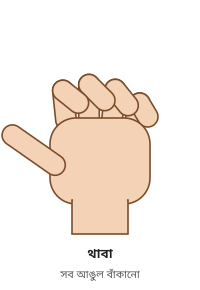

| উৎস | দাবিকৃত অর্থ |
|---|---|
| ৯-দফা | থাবা **বাইরের** দিকে: «مس شيطاني من شيطان العين أو جن طيار» — বদনজরের শয়তান বা উড়ন্ত জিন |
| ৯-দফা | থাবা **ভেতরের** দিকে: «مس شيطاني من القرين» — কারীনের আসর |
| মাফাহিম (কপি) | বাইরের থাবা = কারীন — মূল তালিকার উল্টো (কপি-ভুল) |
| ইনফোগ্রাফিক, ২০২৬ ব্লগ | «الجن صنف الحيوانات قطط/كلاب/أسود» — পশু শ্রেণির জিন (বিড়াল/কুকুর/সিংহ) |
| তারদা | নিচে বাঁকানো "নখর" = উড়ন্ত জিন; থাবা = পশুরূপী জিন |
| ইনফোগ্রাফিক (ছবি-অংশ) | বাঁকানো আঙুল = "তাতরি" জিন, বাধা বা বিচ্ছেদ-জাদুর খাদেম; গোটানো থাবা = একাধিক সত্তা, উঁচু মর্যাদার জিন |

---

## ৩.১৯ তিন আঙুল (বুড়ো আঙুল অনামিকা-কড়ে ধরে রাখে)

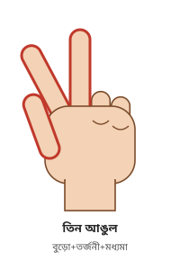

| উৎস | দাবিকৃত অর্থ |
|---|---|
| ২০১৭-সংকলন | «قبض الخنصر والبنصر والإشارة بثلاث أصابع» — খ্রিস্টান জিন (ত্রিত্ববাদ) |
| ৩০-কার্ড | «ديانة الخادم نصرانى وتعنى التثليث» — খাদেম খ্রিস্টান, ত্রিত্ব |
| ৯-দফা | কড়ে ও অনামিকা বন্ধ, মধ্যমা-তর্জনী ফাঁক: «جني يهودي موكل بسحر» — জাদুর দায়িত্বপ্রাপ্ত **ইহুদি** জিন |
| ৯-দফার ২০২৬ সংস্করণ | একই ভঙ্গি = «مارد/سحر موروث» — মারিদ / উত্তরাধিকারসূত্রে পাওয়া জাদু |
| ইনফোগ্রাফিক | তিন আঙুল উঁচু, বুড়ো আঙুল অনামিকা ছুঁয়ে: «سحر التفريق» — বিচ্ছেদ-জাদু |

**অমিল:** একই ভঙ্গি খ্রিস্টান জিন, ইহুদি জিন, মারিদ, বিচ্ছেদ-জাদু — চারটি আলাদা অর্থ।

---

## ৩.২০ বুড়ো আঙুল + কড়ে খোলা

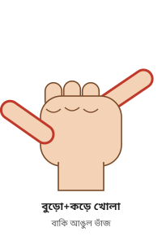

| উৎস | দাবিকৃত অর্থ |
|---|---|
| ৯-দফা | «إشارة اليد بالخنصر والإبهام مع ضم باقي الأصابع إشارة دالة على شيطان الحسد والسحر» — হাসাদ ও জাদুর শয়তান |
| মাওসুআ | বুড়ো + কড়ে = প্রেমিক জিন — মূল তালিকার সঙ্গে বিরোধ (কপি-ভুল) |

---

## ৩.২১ বুড়ো + তর্জনী + কড়ে খোলা

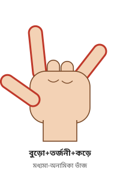

| উৎস | দাবিকৃত অর্থ |
|---|---|
| ৩০-কার্ড | «نوع وديانة العارض (شيطان ماسوني)» — ফ্রিম্যাসনি শয়তান |
| (শিং-এর সঙ্গে মিলিয়ে) | কিছু উৎসে একই ধরনের ভঙ্গি "শয়তান-পূজারি" |

---

## ৩.২২ তর্জনী অর্ধেক বাঁকা ও অন্যান্য তর্জনী-সংকেত

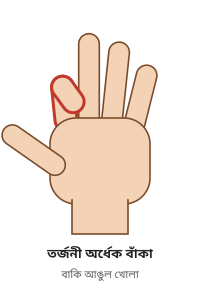

| উৎস | দাবিকৃত অর্থ |
|---|---|
| ৩০-কার্ড | «ثني السبابه نصف دائره» — তর্জনী অর্ধবৃত্তে বাঁকা: «سحر تعطيل وعكوسات» — কাজে বাধা ও উল্টো ফলের জাদু |
| ৩০-কার্ড | তর্জনী বন্ধ মুখে: «سحر ربط اللسان» — জিহ্বা-বন্ধন জাদু; খোলা মুখে: «جان مربوط اللسان» — জিহ্বা-বাঁধা জিন |
| ৩০-কার্ড | তর্জনী বুকে: «سحر وسوسه» — ওয়াসওয়াসার জাদু; পুরো হাত বুকে: «سحر محبه» — ভালোবাসার জাদু |
| ৩০-কার্ড | তর্জনী নিচের দিকে তাক: «سحر مرصود مدفون» — পাহারাদার-যুক্ত দাফন করা জাদু |

---

## ৩.২৩ অন্যান্য বুড়ো আঙুল-সংকেত (ডায়াগ্রাম ছাড়া)

| ভঙ্গি | উৎস | দাবিকৃত অর্থ |
|---|---|---|
| বুড়ো আঙুল তর্জনীর ওপর, বাকি আঙুল লম্বা | ৩০-কার্ড | «سحر ربط ومنع زواج» — বন্ধন ও বিয়ে আটকানোর জাদু |
| বুড়ো আঙুল কড়ে আঙুলের ওপর | ৩০-কার্ড | «سحر تعطيل تخدمه شيطانه» — নারী-শয়তানের খেদমতে বাধার জাদু |
| বুড়ো আঙুল তালুর মাঝে, মধ্যমা তর্জনীর ওপর | ৩০-কার্ড | বাধার জাদু + বাঁধা খাদেম |
| বুড়ো আঙুল-তর্জনী জোরে চাপা, বাকি আঙুল জড়ো | ৩০-কার্ড | «سحر الانتقام» — প্রতিশোধের জাদু |
| বুড়ো আঙুল ফাঁক + বুড়ো আঙুলে ব্যথা | ৩০-কার্ড | «سحر مدفون صنع بالدم» — রক্ত দিয়ে তৈরি দাফন করা জাদু |
| বুড়ো আঙুল মধ্যমা/অনামিকা ছোঁয়া | ৩০-কার্ড | «شيطان هندوسي» — হিন্দু শয়তান |
| ডান বুড়ো আঙুল ওঠা + অবশ | ইনফোগ্রাফিক-পোস্ট | আক্রমণকারী "নিজ জাতির প্রধান" |
| বুড়ো আঙুলের লক্ষণীয় নড়াচড়া | ওয়াশ্শাহ | কারীন |
| বুড়ো আঙুল কাঁপা | ruqyah.in (ইংরেজি) | জিন বের হচ্ছে |
| বুড়ো আঙুল নড়া + ঘাড়/কাঁধে ব্যথা | বুড়ো আঙুল-পোস্ট (২০২৫) | «تسليط أو ربط طاقي» — "শক্তিগত" বন্ধন |
| বুড়ো আঙুল, তর্জনী ও কড়ে জোরে বাইরে + অনামিকা-মধ্যমা ভেতরে চাপা | ওয়াশ্শাহ | «خادم زار» — "যার" খাদেম |

## ৩.২৪ দুই হাতের সম্মিলিত ভঙ্গি (ডায়াগ্রাম ছাড়া)

| ভঙ্গি | উৎস | দাবিকৃত অর্থ |
|---|---|---|
| দুই হাতে হৃদয় আকৃতি | ৩০-কার্ড | «سحر مرصود وعليه حراس» — পাহারাদারসহ জাদু |
| বুড়ো আঙুল-তর্জনী দিয়ে হৃদয়ের দিকে ইশারা | ইনফোগ্রাফিক-পোস্ট | প্রেমিক জিন রোগীকে ভালোবাসে, যেতে চায় না |
| দুই আঙুল ক্রস করা | ৩০-কার্ড | «وجود خادمين فى الجسد ويخدمون نفس الإصابه» — একই আক্রান্তির দুই খাদেম |
| আঙুল একটার ফাঁকে আরেকটা ঢোকানো (বারবার) | ২০২৬ ব্লগ | বাধা বা বন্ধন-জাদু |
| দুই হাতের তালু কাঁপা (একটানা বা থেমে থেমে) | ওয়াশ্শাহ | «مس قرين» — কারীনের আসর |
| তালু উল্টে যাওয়া, আঙুল পিয়ানো বাজানোর মতো নড়া | ওয়াশ্শাহ | কারীন |
| হাতে গোল গোল নড়াচড়া | ২০২৬ ব্লগ | রক্তনালিতে সত্তার চলাচল |
| কনুই থেকে তালু পর্যন্ত স্পন্দন | ২০২৬ ব্লগ | ক্ষতি বের হয়ে যাচ্ছে |
| বাম হাতে খিঁচুনি | বাম-হাত পোস্ট | জাদু, ঠান্ডা বদনজর |
| বাম হাতে ব্যথা বা অবশ | ইনফোগ্রাফিক-পোস্ট | জাদু (কারীন-জাদুর খাদেম, "উম্মার", বৃহস্পতি/শুক্রবারের খাদেম) |
| কড়ে আঙুল তালুতে টোকা দেয় | কড়ে-পোস্ট | আক্রমণকারী ভেঙে পড়ছে, শেষ কাছে |
