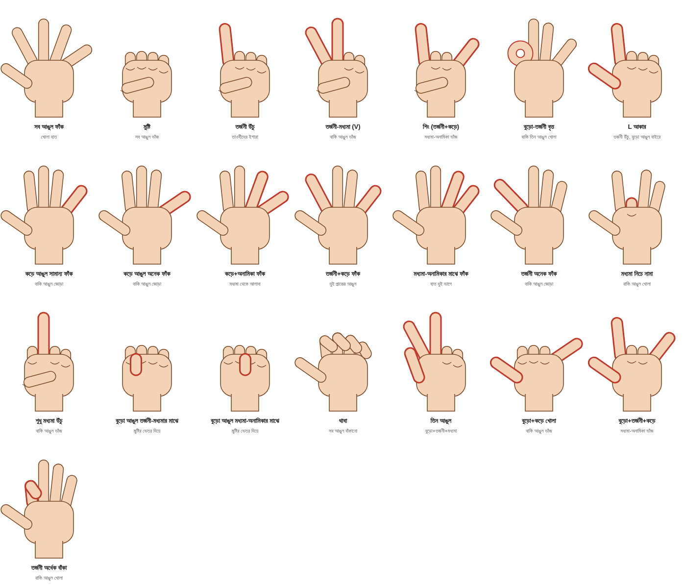

# ইলমুল ইশারা: দাবি, দলিল ও বাস্তবতা

### রুকইয়ার সময় আঙুলের নড়াচড়া দেখে জিন, জাদু ও বদনজর "নির্ণয়" নিয়ে একটি সূত্রভিত্তিক অনুসন্ধান

> খসড়া পাণ্ডুলিপি। এটি প্রকাশের আগে লেখক ও আলেমদের যাচাইয়ের জন্য।

---

## সূচিপত্র

| অধ্যায় | বিষয় |
|---|---|
| [ভূমিকা](00-bhumika.md) | বইটি কেন, কীভাবে লেখা, সূত্রের মান কীভাবে চিহ্নিত |
| [১. পরিচিতি ও ইতিহাস](01-porichiti.md) | সংজ্ঞা, নাম, কে কবে শুরু করলেন, কীভাবে ছড়াল |
| [২. পদ্ধতি ও শর্ত](02-poddhoti.md) | রুকইয়ার বৈঠকে কী দেখা হয়, প্রবক্তাদের নিজেদের শর্ত |
| [৩. ইশারা-অভিধান (ছবিসহ)](03-ishara-ovidhan.md) | প্রতিটি ইশারা, কোন সূত্র কী অর্থ দাবি করে, কোথায় অমিল |
| [৪. সূত্র অনুযায়ী মূল তালিকা](04-sutro-onujayi-talika.md) | প্রতিটি উৎসের তালিকা হুবহু (আরবি + বাংলা) |
| [৫. পায়ের ইশারা ও শরীরের অন্যান্য প্রতিক্রিয়া](05-pa-o-shorir.md) | পা, চোখের পানি, বমি, কাঁপুনি, তাপমাত্রা |
| [৬. পক্ষের যুক্তি ও ফতোয়া](06-pokkhe.md) | কারা সমর্থন করেন, কী দলিলে; ফতোয়াগুলো যাচাই |
| [৭. বিপক্ষের যুক্তি ও ফতোয়া](07-bipokkhe.md) | আলেম, ফতোয়া বোর্ড ও রাকিদের সমালোচনা |
| [৮. চিকিৎসাবিজ্ঞানের দৃষ্টি](08-chikitsa-biggan.md) | আইডিওমোটর, প্রভাবন, ফাংশনাল মুভমেন্ট ডিসঅর্ডার, গবেষণা |
| [৯. বিশ্লেষণ ও উপসংহার](09-bisleshon.md) | বৈপরীত্য, ঝুঁকি, পাঠক ও রাকির জন্য করণীয় |
| [পরিশিষ্ট ক: সূত্রতালিকা](10-sutrotalika.md) | প্রতিটি উৎস, তারিখ, যাচাই-অবস্থা |
| [পরিশিষ্ট খ: ছবির তালিকা](11-chobi.md) | নিজস্ব ডায়াগ্রাম ও রেফারেন্স ছবি |

---

## যাচাই-চিহ্ন (পুরো বইয়ে)

| চিহ্ন | অর্থ |
|---|---|
| **[যাচাইকৃত]** | মূল বা সরকারি উৎসে পড়া হয়েছে (যেমন আলেমের অফিসিয়াল সাইট, ইসলামকিউএ, শামেলা) |
| **[প্রবক্তার সূত্রে]** | শুধু পদ্ধতির প্রবক্তার নিজের ফোরাম বা ব্লগে পাওয়া; স্বাধীনভাবে যাচাই হয়নি |
| **[পরোক্ষ]** | অন্য কারও উদ্ধৃতি বা সার্চের সারাংশ থেকে; মূল পাতা পড়া যায়নি |
| **[পাওয়া যায়নি]** | মূল উৎস খোঁজা হয়েছে, মেলেনি |

বইয়ে যেখানে "দাবি" লেখা, সেটা উৎসের কথা। লেখকের বা এই বইয়ের স্বীকৃতি নয়।

## ছবি সম্পর্কে

- `images/diagrams/` — এই বইয়ের জন্য আঁকা নিজস্ব প্রতীকী হাতের ডায়াগ্রাম। বইয়ে স্বাধীনভাবে ব্যবহার করা যাবে।
- `_reference/` — ব্লগ, টিকটক ও ইউটিউব থেকে সংগৃহীত ছবি, ভিডিওর স্থিরচিত্র ও মূল লেখা। এগুলো অন্যের কপিরাইট; শুধু গবেষণার রেফারেন্স। এই ফোল্ডার git-এ রাখা হয়নি (রিপোজিটরি পাবলিক)। বইয়ে ছাপতে হলে মালিকের অনুমতি নিন, অথবা নিজস্ব ডায়াগ্রাম ব্যবহার করুন।
